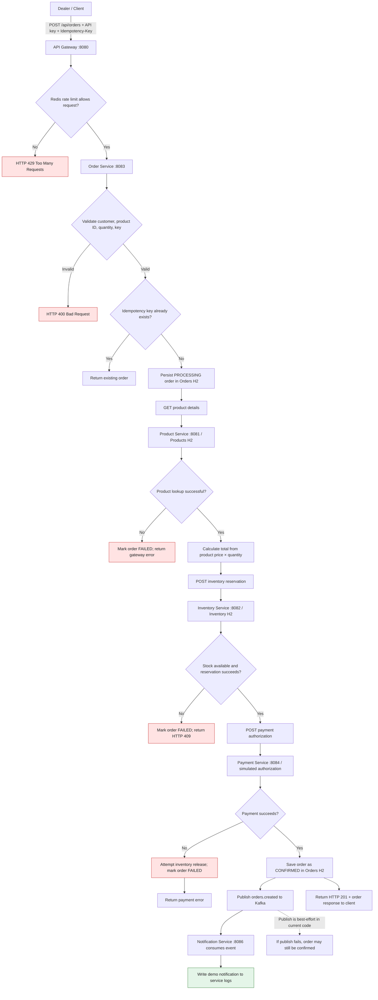
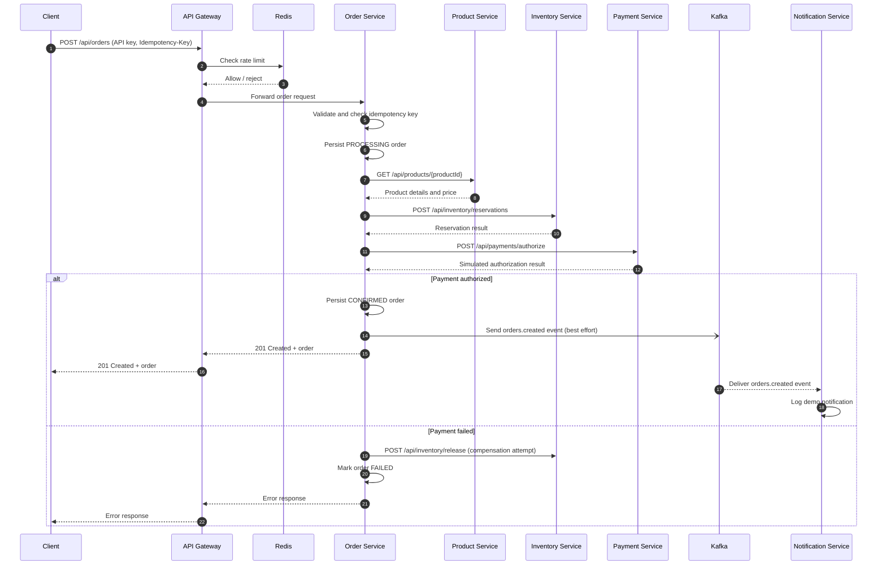

# Fertilizer Order Management Platform

Java 21 / Spring Boot 3.4 microservices starter for fertilizer catalog, inventory, order intake, simulated payment, delivery and Kafka-driven notifications.

> **Honest capacity statement:** this repository is configured for performance testing and documents a path to 10,000 TPS. It has NOT been benchmarked or certified to sustain 10,000 TPS. The current order request still performs synchronous product, inventory and payment calls, so this baseline should not be described as proven for that throughput. See `docs/10k-tps-and-data-ownership.md` for the required scale-out architecture.

## Services

| Service | Port | Owns / provides |
|---|---:|---|
| API Gateway | 8080 | Routing and Redis-backed per-client limits |
| Product | 8081 | Fertilizer catalog; owns its H2 file database `products` |
| Inventory | 8082 | Stock and reservations; owns its H2 file database `inventory` |
| Order | 8083 | Order records and idempotency keys; owns its H2 file database `orders` |
| Payment | 8084 | Demo payment authorization (in-memory only; not production durable) |
| Delivery | 8085 | Demo shipment records (in-memory only; not production durable) |
| Notification | 8086 | Consumes order events and logs notifications |

## Database choice: H2

Product, inventory and order services each use a separate file-based H2 database, persisted in its own Docker named volume. Payment and delivery have H2 configured for future JPA persistence, but their current demo endpoints still use in-memory state. H2 is intended for local development and functional testing; it is not appropriate as the database tier for a production 10,000 TPS deployment. Each domain remains the sole owner of its own data; do not share H2 files between services. H2 console is disabled by default.

## Run locally

Requirements: Docker Desktop + Compose. Run from this directory:

```bash
docker compose up --build -d
docker compose ps
```

The first run creates each H2 database automatically. Docker named volumes preserve database files across container restarts. `docker compose down -v` deletes those volumes and all local database data.

## Try it

```bash
curl http://localhost:8080/api/products
curl -i -X POST http://localhost:8080/api/orders \
  -H 'Content-Type: application/json' \
  -H 'X-API-Key: dealer-demo-001' \
  -H 'Idempotency-Key: demo-order-0001' \
  -d '{"customerId":"dealer-100","productId":1,"quantity":2}'
```

A repeated `Idempotency-Key` returns the existing order instead of intentionally creating another order. This reduces duplicate effects but does not replace end-to-end idempotency in inventory/payment and durable Saga recovery.


## End-to-end order request flow

The diagram below reflects the current implementation. The HTTP order path is synchronous through product lookup, inventory reservation, and simulated payment authorization. Kafka notification is attempted after the order is confirmed. Delivery is a separate demo API and is not automatically invoked by order creation.



### Sequence view



## Single source of truth and service data ownership

- **Product Service** is authoritative for product catalog and price.
- **Inventory Service** is authoritative for stock and reservations.
- **Order Service** is authoritative for order state and idempotency keys.
- **Payment Service** and **Delivery Service** currently use in-memory demo state; durable persistence is not yet implemented even though H2 configuration is present.
- **Redis** stores rate-limit state; it is not the source of truth for orders or inventory.
- **Kafka** transports events; messages and consumer state are not substitutes for the owning service's business database.

Services must access another domain through its API or events, not by opening another service's H2 database file. The current order workflow uses best-effort compensation and best-effort Kafka publication; use a durable Saga plus transactional outbox and end-to-end idempotency before production use.

## Rate limiting and load test

The gateway rate limiter is per API key: 100 tokens/sec with a burst of 200 in the starter config. Aggregate throughput depends on gateway replicas, Redis capacity, API-key distribution, downstream services, and the request mix. Do not simply set one client key to 10,000 TPS.

Use k6 from a machine with k6 installed. Begin with a low rate and increase gradually:

```bash
k6 run -e BASE_URL=http://localhost:8080 -e RATE=100 -e DURATION=1m load-test/k6-orders.js
```

A 10,000 request/sec test should be run against a production-like multi-node environment, with a separate load generator, sufficient distinct authenticated clients, pre-provisioned stock, and defined latency/error SLOs. The included local Compose stack is for functional development, not a 10k TPS proof.

## Production gaps

- Replace synchronous orchestration with durable asynchronous acceptance + transactional outbox + Kafka consumers + Saga state machine and compensation.
- Persist payment and delivery state; the included implementations are in-memory demos.
- Add service-specific DB users/credentials, Flyway migrations, backup/restore, TLS, secrets management, OAuth2/JWT, authorization, audit logs and observability.
- Add idempotency to reservation/release/payment operations, including durable unique keys.
- Use a multi-broker Kafka cluster (replication factor 3), appropriate partitions, and monitor lag.
- Load-test and tune pools, indexes, partitioning, gateway replicas, Redis and consumer concurrency based on measurements.
