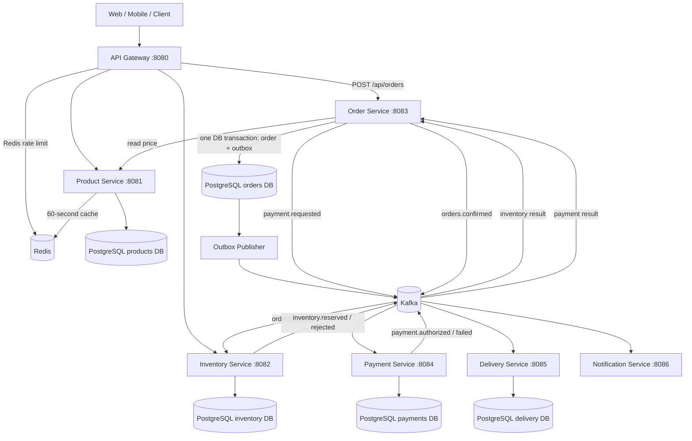
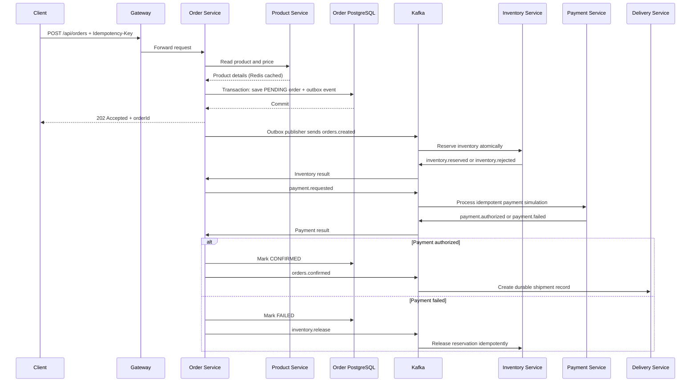

# Fertilizer Order Platform — Java 21 / Spring Boot Microservices

A runnable local-development reference project demonstrating asynchronous order acceptance, Kafka-based Saga
orchestration, PostgreSQL service-owned data, an order transactional outbox, Redis product caching and API rate
limiting, idempotent inventory reservations, persistent payment simulation, delivery creation, and a k6 load-test
profile.

> **Capacity statement:** this is a scalable reference implementation, not a verified 10,000-TPS production system. No
> 10k-TPS benchmark has been run here. Actual capacity depends on hardware, Kafka/PostgreSQL topology, payloads, order
> mix, downstream services, and load-test results. The included Compose stack is a single-node development environment and
> is not highly available.

## Architecture



### End-to-end order flow



## Services and ports

| Service | Port | Owns |
|---|---:|---|
| API Gateway | 8080 | Routing and Redis rate limiting |
| Product Service | 8081 | Product catalog; Redis read cache |
| Inventory Service | 8082 | Available stock and unique reservation per order |
| Order Service | 8083 | Order state, idempotency keys, transactional outbox, Saga orchestration |
| Payment Service | 8084 | Durable payment simulation, unique payment per order |
| Delivery Service | 8085 | Durable shipment records created from confirmed-order events |
| Notification Service | 8086 | Consumes confirmed-order events (logs a demo notification) |
| PostgreSQL | 5432 | Separate logical database per service |
| Redis | 6379 | Gateway rate limiting and product cache |
| Kafka | 9092 | Order, inventory, payment and confirmation events |

Each service writes only to its own logical database. The Compose PostgreSQL instance and credentials are shared for
local development only; use independent credentials and appropriately managed databases in production.

## Requirements

- Docker Engine and Docker Compose v2
- `curl` (or PowerShell `Invoke-RestMethod`) for API tests
- Optional: [k6](https://k6.io/) to run load tests
- Optional: Java 21 and Maven 3.9+ to build locally outside Docker

## Start the complete platform

From the project root (optionally copy `.env.example` to `.env` and set local credentials first):

```bash
docker compose up --build -d
```

Check service status and logs:

```bash
docker compose ps
docker compose logs -f order-service inventory-service payment-service
```

Wait for services to finish starting. Health endpoints:

- `http://localhost:8080/actuator/health` — gateway
- `http://localhost:8081/actuator/health` — product
- `http://localhost:8082/actuator/health` — inventory
- `http://localhost:8083/actuator/health` — order
- `http://localhost:8084/actuator/health` — payment
- `http://localhost:8085/actuator/health` — delivery
- `http://localhost:8086/actuator/health` — notification

The sample catalog is seeded on first startup:

| Product ID | SKU | Example price (INR) |
|---:|---|---:|
| 1 | UREA-50 | 520.00 |
| 2 | DAP-50 | 1,350.00 |
| 3 | NPK-25 | 890.00 |

The inventory seed values are intentionally large for load-test demonstrations. They are not real business stock values.

## Create an order

**Linux/macOS/Git Bash:**

```bash
curl -i -X POST http://localhost:8080/api/orders \
  -H 'Content-Type: application/json' \
  -H 'X-API-Key: local-demo-client' \
  -H 'Idempotency-Key: order-demo-0001' \
  -d '{"customerId":"C1001","productId":1,"quantity":2}'
```

**PowerShell:**

```powershell
$body = @{ customerId = 'C1001'; productId = 1; quantity = 2 } | ConvertTo-Json
Invoke-RestMethod -Method Post -Uri 'http://localhost:8080/api/orders' `
  -Headers @{ 'X-API-Key' = 'local-demo-client'; 'Idempotency-Key' = 'order-demo-0001' } `
  -ContentType 'application/json' -Body $body
```

Expected response is **HTTP 202 Accepted**, containing `orderId` and `status: PENDING`. The order then progresses
asynchronously. Query its state using the returned ID:

```bash
curl http://localhost:8080/api/orders/REPLACE_WITH_ORDER_ID
```

Expected eventual state is `CONFIRMED` when inventory and the demo payment flow succeed, or `FAILED` when inventory is
unavailable or a payment step fails. Reusing the same idempotency key returns the original order instead of creating
another order. Use a new key for a new order.

Additional endpoints:

- `GET /api/products`
- `GET /api/products/1`
- `GET /api/inventory/1`
- `GET /api/orders`
- `GET /api/orders/{orderId}`
- `GET /api/payments/{orderId}` after payment processing
- `GET /api/deliveries/{orderId}` after confirmation

## How consistency is handled

- **Order acceptance:** the order row and `orders.created` outbox record are written in one PostgreSQL transaction. An
  asynchronous scheduled publisher claims pending rows in PostgreSQL using `FOR UPDATE SKIP LOCKED` plus a 60-second
  claim lease, so horizontally scaled Order Service replicas do not all publish the same batch. A crash after publish
  but before marking an event published can still cause duplicate delivery, so consumers must remain idempotent.
- **Inventory:** stock is decremented with a conditional atomic SQL update. A database reservation record with a unique
  order ID prevents double reservation. Releases are idempotent.
- **Payment:** payment records are persisted and unique per order. This project simulates an authorization; it does not
  charge a real card or connect to a payment gateway. A real provider must receive a stable idempotency key and its
  ambiguous timeout state must be reconciled before compensation.
- **Saga:** order state changes through `PENDING`, `PAYMENT_PENDING`, `CONFIRMED`, and `FAILED`. Payment failure
  triggers an inventory-release event. Downstream consumers can retry and duplicate events are expected in an
  at-least-once system.
- **Dead-letter topics:** listener failures are retried with backoff, then routed to a `.DLT` topic. Monitor DLT volume
  and provide an operational replay/recovery process before production.
- **Delivery and notification:** confirmed-order events create a durable shipment record and log a demo notification. No
  real courier, email, SMS, or push provider is configured.

## Rate limiting and scaling

The Gateway uses Redis-backed token-bucket rate limiting. Defaults in the local configuration are 1,000 tokens/second
and a burst of 2,000 **per resolved API key**. This is a per-client limit, not a guaranteed platform throughput figure.
A client sending 10,000 requests/sec with one key will be throttled by design. Use different client keys only when they
represent distinct legitimate clients; do not use key rotation to bypass production limits.

To scale application instances in a production orchestrator, configure multiple replicas, resource requests/limits,
readiness/liveness probes, rolling updates, and autoscaling. Scale Kafka consumers using consumer lag and processing
latency, not CPU alone. Database pool limits must be budgeted across all replicas; multiplying a 20-connection pool by
many pods can exhaust PostgreSQL connections.

The local Compose setup intentionally has one Kafka broker and one PostgreSQL instance. For production, use multi-AZ
managed Kafka/PostgreSQL/Redis or equivalent HA deployments, Kafka replication factor 3 (and suitable min ISR),
TLS/SASL/ACLs, secrets management, backups, migrations, alerting, and disaster-recovery testing. Local topic replication
factor is 1 because Compose runs a single broker.

## Load testing with k6

Start at low rates and ramp gradually. Do not begin with 10,000 requests/sec on an unmeasured environment.

```bash
BASE_URL=http://localhost:8080 RATE=100 DURATION=1m k6 run load-test/k6-orders.js
BASE_URL=http://localhost:8080 RATE=1000 DURATION=2m k6 run load-test/k6-orders.js
BASE_URL=http://localhost:8080 RATE=10000 DURATION=5m PRE_VUS=1000 MAX_VUS=5000 k6 run load-test/k6-orders.js
```

PowerShell example:

```powershell
$env:BASE_URL='http://localhost:8080'; $env:RATE='1000'; $env:DURATION='2m'; k6 run load-test/k6-orders.js
```

The load test checks that order creation returns HTTP 202 and uses unique idempotency keys. Track request rate, p95/p99
latency, failures, PostgreSQL pool utilization, Kafka consumer lag, outbox age, DLT messages, and the eventual count
of `CONFIRMED`/`FAILED` orders. The test generator must have enough CPU/network capacity. HTTP acceptance throughput is
not the same as completed-order throughput. For 10k TPS, test the full system and verify stable backlog and business
correctness over an extended run.

## Useful commands

```bash
# Tail all logs
docker compose logs -f

# Stop containers but retain database volume
docker compose down

# Stop and DELETE local database data (destructive)
docker compose down -v
```

## Production gaps to close before real money or 10k TPS

1. Replace demo payment authorization with a real provider integration, provider-side idempotency, reconciliation, and
   secure secret storage.
2. Use managed multi-node Kafka/PostgreSQL/Redis with replication, authentication, TLS, backups, and tested recovery
   procedures.
3. Add OAuth2/JWT authorization, tenant/customer authorization checks, request size limits, and security hardening; the
   local demo does not implement full authentication.
4. Add a proper database migration tool (Flyway/Liquibase) rather than relying on Hibernate `ddl-auto=update`.
5. Add end-to-end tracing, dashboards, SLO alerts, consumer lag/outbox-age/DLT alerts, and controlled DLT replay.
6. Benchmark representative order mixes and payloads; tune partition count, consumers, pools, cache TTLs, JVM,
   CPU/memory and database indexes from evidence.
7. Run concurrency, duplicate-event, crash-recovery, payment-timeout, stock-contention, failover, and long-duration soak
   tests.

## Troubleshooting

- If the Gateway returns `429`, the per-key Redis rate limit is active. Reduce load or configure an appropriate limit
  for the test environment.
- If an order stays `PENDING`, inspect `order-service`, `inventory-service`, Kafka topics/consumer lag, and the outbox
  table.
- If an order stays `PAYMENT_PENDING`, inspect `payment-service` logs and the `payment.requested` topic.
- If a message lands in a `.DLT` topic, inspect the payload and consumer logs before replaying it.
- If you change the Postgres init SQL after the database volume already exists, it will not run again automatically. For
  a disposable local environment only, `docker compose down -v` recreates the databases and removes all stored data.
